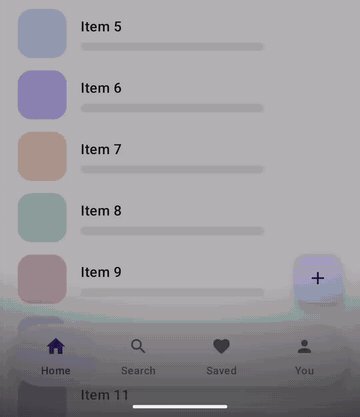

# Lumen

**Jetpack Compose components that answer the finger with light.**

No ripples. A finger on a Lumen component carries a light: a glow under it, the tab it is on lit up,
the plate leaning towards it. Slide it along and the light goes with it, a soft tick under the finger
at every tab it crosses; lift and the lit tab is picked. Everything that moves is a spring — and the
haptics follow the springs, so the finger feels every bounce the eye sees, each one fainter.

<p align="center">
  
</p>
<p align="center"><sub>
  Real time, on an emulator: a press on the selected tab, a slide along the bar and back, quick taps,
  a slide off the island that picks nothing, and the bar folding as the page scrolls, the FAB riding it ·
  <a href="docs/media/lumen.mp4">mp4</a>
</sub></p>

- **`FloatingNavBar`** — a bottom navigation bar that floats as an island and **folds** as the page is
  read (labels away, island narrowed into discs) and opens as it comes back. The selected tab is a
  **jelly plate**: its two edges travel on their own, overshoot and come back, the mark it lands on is
  knocked over and pops, and the island round it gives way at the ends and squashes on every landing.
  It refuses to show labels that would not fit at 10sp, and hands them to the screen reader instead.
- **`LightTabs`** — the same island and touch for a row of tabs inside a page (a segmented control),
  that picks the roomiest arrangement that fits: labels beside the icons, under them, or gone.
- **`GlossCard`** — a raised card that tilts towards the finger in 3D, its gloss sliding under it, the
  slab showing its thickness, the shadow moving away from the light. Optionally it answers the phone
  turning in the hand.
- **`BounceHaptics`** — haptics that follow a spring: a press, a landing, and every rebound after it,
  each as strong as the bounce, using `VibrationEffect.Composition` primitives where available.
- **`IslandMaterial`** — draw the bar's island with anything: glass from
  [compose-glass](https://github.com/angelomarzocchi/compose-glass), a blur, a texture.

## Install

Published on [JitPack](https://jitpack.io/#angelomarzocchi/compose-lumen).

```kotlin
// settings.gradle.kts
dependencyResolutionManagement {
    repositories {
        google()
        mavenCentral()
        maven("https://jitpack.io")
    }
}

// build.gradle.kts
dependencies {
    implementation("com.github.angelomarzocchi:compose-lumen:1.1.0")
}
```

minSdk 24, compileSdk 37, Compose BOM `2026.09.00` or later, Material 3.

## FloatingNavBar

```kotlin
val barState = rememberFloatingNavBarState()
var section by remember { mutableIntStateOf(0) }
val items = listOf(
    FloatingNavItem("Home", rememberVectorPainter(Icons.Default.Home)),
    FloatingNavItem("Search", rememberVectorPainter(Icons.Default.Search)),
    FloatingNavItem("Saved", rememberVectorPainter(Icons.Default.Favorite)),
    FloatingNavItem("You", rememberVectorPainter(Icons.Default.Person)),
)

Box(Modifier.fillMaxSize()) {
    // The page passes under the bar: pad the scrolling content, not its container.
    LazyColumn(state = list, contentPadding = PaddingValues(bottom = 140.dp)) { … }

    FloatingActionButton(
        onClick = {},
        modifier = Modifier
            .align(Alignment.BottomEnd)
            .navigationBarsPadding()
            .padding(end = 20.dp, bottom = 108.dp)
            .graphicsLayer { translationY = barState.drop },   // rides the fold and the squash
    ) { Icon(Icons.Default.Add, null) }

    FloatingNavBar(
        items = items,
        selectedIndex = section,
        onSelect = { section = it },
        folded = scrollingDown,          // your quick-return signal
        state = barState,
        modifier = Modifier.align(Alignment.BottomCenter),
    )
}
```

- The bar pads itself for the system bars and is always the open bar's height, so a `Scaffold` padding
  the page by it never relayouts the page as it folds.
- `FloatingNavBarState.drop` is how far the bar's top has come down (fold + squash), in pixels; read it
  in a `graphicsLayer`, never in composition.
- `FloatingNavBarState.tabInWindow(index)` is a tab's plate in window coordinates this frame — the shape
  a new section can grow out of.
- `onSelect` hears the selected tab too: scroll its page to the top.
- Colours default to the Material theme (`LumenDefaults.colors()`): island `surfaceContainerHigh`,
  plate `primaryContainer`/`onPrimaryContainer`, tabs `onSurfaceVariant`, lit `primary`. The light's
  strength adapts to a light or dark island (`FingerLight.Day` / `Night`).

### In glass

Pass an `IslandMaterial` and the bar draws its island with it — the plate included, as the material
wants. With [compose-glass](https://github.com/angelomarzocchi/compose-glass) the selected tab becomes a
light inside the glass:

```kotlin
FloatingNavBar(
    items, section, { section = it },
    material = rememberGlassIsland(backdrop, GlassMaterial.clear(dark), rememberTiltKeyLight()),
)
```

`rememberGlassIsland` is a 40-line adapter; copy it from
[the compose-glass README](https://github.com/angelomarzocchi/compose-glass#a-navigation-bar-in-glass).
Lumen does not depend on Glass.

## LightTabs

```kotlin
var view by remember { mutableStateOf<Any>("list") }
LightTabs(
    tabs = listOf(
        lightTab("list", "List", rememberVectorPainter(Icons.AutoMirrored.Filled.List)),
        lightTab("calendar", "Calendar", rememberVectorPainter(Icons.Default.DateRange)),
        LightTab("story", "Story"),                       // a tab can be its word alone
    ),
    selectedId = view,
    onSelect = { view = it },
    fillWidth = true,                                   // share the width equally
)
```

`LightTab.icon` is a slot (`@Composable (selected, tint) -> Unit`) for marks that animate;
`LightTab.description` is what TalkBack says when the label alone would read badly. Labels never wrap:
the row measures them first and gives ground a step at a time — padding, then equal widths, then the
label under the icon, and last of all the label itself, which then goes to the screen reader.

`material` puts the row in glass, or any other `IslandMaterial`, exactly as for `FloatingNavBar` (the
`GlassIsland` adapter above works for both). `inScrollingPage = false` is for a row over something that
does not scroll, a viewfinder say: the press is felt as the finger lands.

`LightTabIcons` is the same row as its marks alone, a 48dp square each with the selected one's plate a
disc: for a pair of views whose labelled tabs have scrolled away. It draws no island of its own, so it
can sit in a toolbar's; the names go to the screen reader.

## LightActions

```kotlin
LightActions(
    actions = listOf(
        LightAction("Share", rememberVectorPainter(Icons.Default.Share), onClick = ::share),
        LightAction("Delete", rememberVectorPainter(Icons.Default.Delete), onClick = ::delete, enabled = canDelete),
    ),
    modifier = Modifier.width(240.dp).height(60.dp),
)
```

The bar's island and its light for a row of things to do rather than places to be: no plate, and lifting
the finger on an action does it, after it has sunk and before it springs back out. It is as big as its
modifier, cut into equal cells. `material` puts it in glass as the bar; there `IslandLights.selection` is
always empty, so a material should leave its selection light off.

## GlossCard

```kotlin
GlossCard(
    modifier = Modifier.fillMaxWidth().height(160.dp),
    colors = GlossCardDefaults.colors(base = MaterialTheme.colorScheme.primary),
    tiltWithDevice = true,     // the phone's turn tilts it too; off in battery saver
    onClick = { open(task) },
) {
    Text("Run 5 km", Modifier.padding(20.dp), style = MaterialTheme.typography.headlineSmall)
}
```

Inside a list it lets the list scroll: a finger that sets off up or down is the list's, and the card
settles back. `GlossCardDefaults.Violet` is the card these components were born with.

`GlossCardSurface` is the card's body alone — slab, face, gloss, edge lights — for a card that moves
in ways of its own (in a stack, opened into a sheet) and tilts itself: put it first in a `Box` and hand
it where the tilt has the slab and the gloss.

## Building blocks

- `BounceHaptics` (`rememberBounceHaptics()`): `press()`, `bounce(strength, landing)`.
  `bounceStrength(overshoot, full, floor)` turns an overshoot into a strength, `ReboundWatch` spots the
  rebounds of any `animateTo` — feed it `value`/`velocity` each frame. Every vibration is a touch
  vibration: the user's touch-feedback setting turns it down or off.
- `GyroTilt` (`rememberGyroTilt(enabled, idle)`), `GyroTiltFilter`: a device tilt that answers the
  wrist turning, not the angle the phone is held at, clamped to ±6°. `rememberHasTiltSensor()`.

## Demo

`demo/` puts every component on one scrolling page, with the bar folding as you scroll and a FAB
riding it. `ShowcaseActivity` is the recording above: it plays by itself, dispatching real touch
events (`adb shell am start -n io.github.angelomarzocchi.lumen.demo/.ShowcaseActivity`). Run it on a phone: the haptics need a vibrator, and the tilt a rotation sensor.

## Tests

```
./gradlew :lumen:testDebugUnitTest
```

JVM tests for the jelly's arithmetic (rebounds felt and fading, the pill thinning as it stretches and
pressing into the wall but never through it), the gyro filter, and Robolectric tests for the components
under a finger: a tap picks, a slide picks where it lifts, a slide off the island picks nothing, the bar
folds and unfolds, labels that cannot fit go to the screen reader, and a card tilts towards the finger
and settles back.

## Using it with an AI coding assistant

[`skills/compose-lumen/SKILL.md`](skills/compose-lumen/SKILL.md) teaches an LLM to use Lumen correctly.
With Claude Code, copy the folder into your project's `.claude/skills/`.

## License

Apache 2.0 — see [LICENSE](LICENSE).
